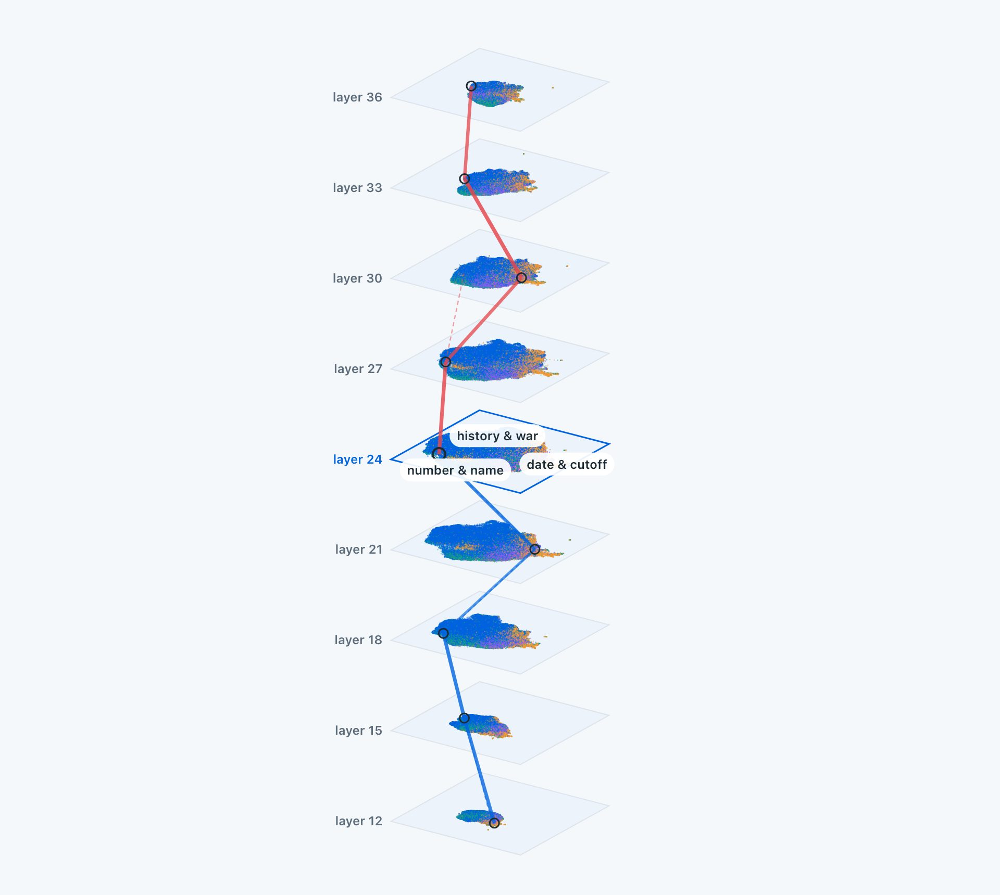

# Glimmer Scope

Looking inside Muse Glimmer 30B: sparse autoencoders on nine of its layers, every feature that fires
labeled, tested for steering, and followed from layer to layer.

**[Try it live on Hugging Face](https://huggingface.co/spaces/rob-x-ai/glimmer-scope)** ·
[the 9 SAEs](https://huggingface.co/kroonen-ai/glimmer-scope-saes) ·
[Muse Glimmer 30B](https://huggingface.co/meta-models/Muse-Glimmer-30B)



A sparse autoencoder (SAE) splits what a layer of the model computes into tens of thousands of
features, most of which stand for one recognizable thing: a subject, a style, a piece of syntax. I
trained one on every third layer of Glimmer's residual stream, from 12 to 36 of its 52 layers, and
built everything around them that I needed to understand and use those features:

- **a catalog** of where each feature fires, from 5M tokens of web and chat text
- **a label** for every feature that fired, written by Muse Spark 1.3 from those examples
- **a steering test**: the feature is turned up while Glimmer answers neutral questions, and Spark
  judges whether the answers move toward that subject and still read well
- **cross-layer links** that match each feature to the ones it fires with on the next layer, so a
  concept can be followed from layer 12 to 36: where it starts, splits, merges and ends
- **28 character archetypes** found as steering directions on every layer
- **maps, a nine-layer atlas and Glimmer Studio**, a chat where any steerable feature becomes a
  dial on a quantized Glimmer running locally

## What it found

| | |
| --- | --- |
| Layers | 9, every third from 12 to 36 |
| Features that fired | 519,383, every one labeled |
| Steering tests | more than 170,000 |
| Threads through all nine layers | 43% of features |

**Steering peaks in the middle of the network.** About 10 to 11% of tested features steer cleanly
at layers 21, 24 and 27, against 1 to 4% near the start and the end (Muse Spark's grades).

**There is a stable backbone.** 43% of features belong to a thread that runs through all nine
layers, and 31% live on one layer only. Shallow layers keep their concepts (62% of layer 12 runs all
the way), deep ones add their own (49% of layer 36 exists there only).

**Characters live at every depth.** Archetypes from pirate captain to gaslighter show up as steering
directions on every layer, and the most play cleanly at layer 24 (19 of 28).

## Built during the hackathon

Everything in this repository was built during the Meta Global AI Developer Hackathon, between October 28
and November 4, 2026. The first commit is the SAE pipeline on October 28, and the history shows every step
after it.

| Days | What was built |
| --- | --- |
| Oct 28 | the SAE pipeline, the first SAE (layer 24), labels and steering tests with Muse Spark, character archetypes, Glimmer Studio |
| Oct 29 to 30 | feature maps, cross-layer matching, the SAEs for layers 12 and 36, a label for every feature that fires |
| Oct 31 to Nov 1 | the site, the SAEs for layers 15 to 33 on AWS, a steering test for every feature, screening for Meta's content filter, safe browsing |
| Nov 2 to 3 | the nine-layer atlas, threads through the layers, the findings, the SAE release and the Hugging Face Space |

## Quickstart

```
pip install -r requirements.txt
cp .env.example .env      # then fill in META_API_KEY
python -m pytest          # 27 tests, on CPU
```

Load one of the trained SAEs and read a layer of Glimmer with it:

```python
from pathlib import Path
from huggingface_hub import hf_hub_download
from scope.sae import TopKSAE

repo = "kroonen-ai/glimmer-scope-saes"
hf_hub_download(repo, "layer-24/cfg.json")
sae = TopKSAE.load(Path(hf_hub_download(repo, "layer-24/sae.safetensors")).parent)

# resid: Glimmer's residual stream after layer 24, [tokens, 6656] (scope.model.residual reads it)
values, features = sae.encode(resid * sae.cfg.input_scale)
```

To steer instead, add `sae.steering_vector(feature, strength)` to the residual stream after the layer;
`scope.model.steering` does that as a context manager around `model.generate`.

## How it works

| Step | What it does | Code |
| --- | --- | --- |
| `train` | streams web text (FineWeb-Edu) and chat (UltraChat, in Glimmer's own template) through the model up to one layer and trains a TopK SAE on the activations: 65,536 features, k = 64, 100M tokens | `scope/train.py`, `scope/sae.py` |
| `catalog` | for every feature: firing rate, mean and peak activation, and the contexts where it fires hardest | `scope/interpret.py` |
| `label` | Muse Spark names each feature from its top contexts, with a kind (concept, syntax, token, format) and a guess at how steerable it is | `scope/label.py` |
| `sweep` | adds a feature's direction at several strengths to neutral prompts; Spark rates concept and fluency per strength and says what the steering did | `scope/steerability.py` |
| `persona_scan`, `archetype`, `retarget` | finds features and blends that make Glimmer play a character, then judges them for that character | `scope/archetype.py`, `scope/personas.py` |
| `crosslayer` | runs text through the model once with two neighboring SAEs and matches features by how they fire together | `scope/crosslayer.py` |
| maps and atlas | lays each layer's features out by their decoder directions, lines the nine layers up on their cross-layer anchors, and builds the site | `scripts/feature_map.py`, `scripts/atlas_nine.py`, `scripts/public_site.py` |

Every step is a function in `modal_app.py`. They run on [Modal](https://modal.com), or on any box
with one 96 GB GPU through `scripts/run_here.py`:

```
modal run modal_app.py::train --layer 24
python scripts/run_here.py catalog --run layer24-64k-k64
python scripts/run_here.py label --run layer24-64k-k64 --everything
python scripts/run_here.py sweep --run layer24-64k-k64 --n-features 30000
python scripts/run_here.py crosslayer --runs layer21-64k-k64,layer24-64k-k64
```

`aws/` has the setup and idle guard I used on a single g7e instance, and `llama.cpp/` a small server
patch for steering per request, which Studio uses to apply dials on a quantized Glimmer.

### Settings

| Variable | Used for |
| --- | --- |
| `META_API_KEY` | Muse Spark, for labels and judging |
| `GLIMMER_RUNS` | where the runs live on a workstation (default `runs/`) |
| `GLIMMER_SAFETY_PATTERNS` | the private safety patterns, see below |
| `LOCAL_LLM_URL`, `LOCAL_LLM_MODEL` | a local model behind an OpenAI-compatible endpoint, for what Spark should not see |
| `GLIMMER_BUCKET` | the S3 bucket the GPU box syncs to |

## Safety

Some findings could be upsetting, so we filter them with safe browsing. This repository leaves out:

- **the keyword patterns** used to screen requests to Spark and to flag safety-relevant features.
  `scope/safety.py` loads them from a private file (`GLIMMER_SAFETY_PATTERNS`). Without it nothing
  is screened or flagged, and the rest of the pipeline works the same.
- **the activation data and the steering results**, including any strength at which a feature
  takes effect.

The trained SAEs themselves are on Hugging Face, at
[kroonen-ai/glimmer-scope-saes](https://huggingface.co/kroonen-ai/glimmer-scope-saes).

Judge requests that would trip Meta's content filter are never sent to Spark; those replies are
kept and graded separately.

## Built with

[Muse Glimmer 30B](https://huggingface.co/meta-models/Muse-Glimmer-30B) (open weights) and Muse Spark 1.3 through the
Meta Model API, for the Meta AI hackathon. Compute from Modal and AWS.

## License

Apache 2.0, see [LICENSE](LICENSE). Copyright 2026 Robin Kroonen.

Kroonen AI
